I build machine learning that catches fraud and attacks, and I study how to secure the AI agents that are starting to act, pay and talk to each other on our behalf.

### What I work on

**Fraud and identity.** Payment fraud, synthetic and stolen identities, account takeover and mule networks. Fraud is a network problem: rings share devices, addresses and cards, so I model transactions as graphs rather than flat rows, and I care about the parts that make it hard in production, like extreme class imbalance, labels that arrive weeks late and adversaries who adapt.

**AI for cybersecurity.** Anomaly detection on logs and network behaviour, and LLM agents that help triage alerts without becoming a new attack surface.

**Agent-to-agent security.** Protocols like [A2A](https://a2a-protocol.org) and [MCP](https://modelcontextprotocol.io) define how agents find and call each other. They say little about who an agent really is, what it is allowed to do, or what happens when one agent passes a poisoned instruction to the next. That trust layer is the problem I'm most interested in.

### Toolkit

`Python` `SQL` `PyTorch` `scikit-learn` `XGBoost` `graph ML` `LLM APIs` `agent orchestration` `MCP` `A2A`

### Questions I'm working on

- Can a model flag a synthetic identity before its first fraudulent transaction, from how it is connected rather than what it has done?
- When agents delegate to other agents, how do you prove the original user authorised the action at the end of the chain?
- What does a fraud detector look like for agent traffic, where the "customer" is software and can retry a thousand times a second?

### Research

Working toward a first paper on security for agent-to-agent systems. Experiments and write-ups will appear here as they're published.

### Get in touch

Open to conversations about fraud ML, security ML and AI security roles and research.
**vimalesh.boorle3@gmail.com**
